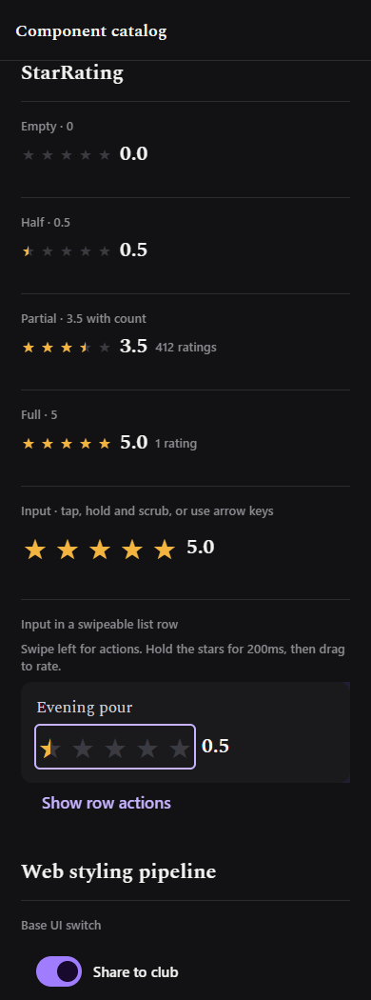
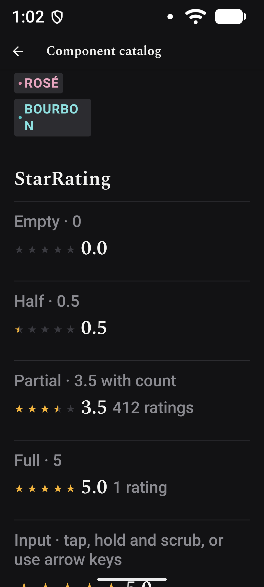
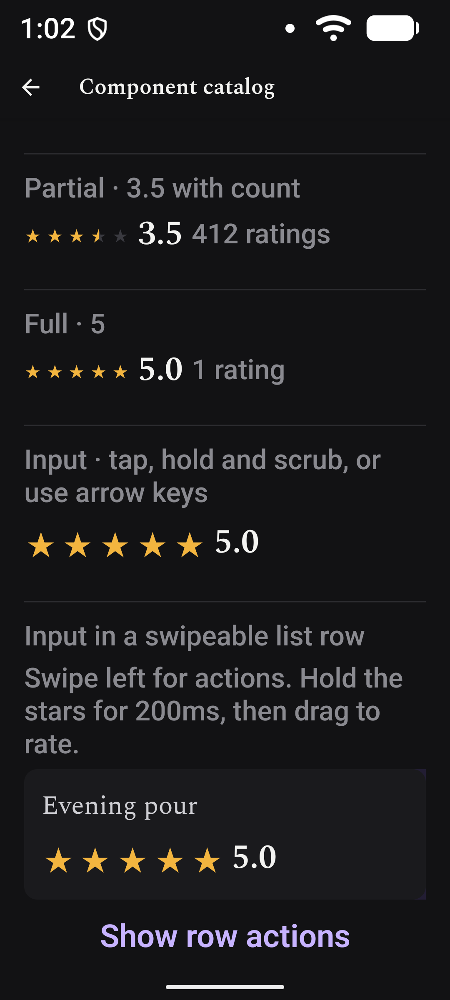

# STO-616 validation

StarRating component and its six `/dev/catalog` examples, checked on October 16,
2026 with Expo SDK 58 / React Native 0.88.

## Automated

- `pnpm check`: lint, both workspace typechecks, three rating behavior tests,
  contrast, and token CSS freshness pass. Rating tests also run in CI.
- Tests cover half-step rounding/clamping, pointer geometry at 16pt and 30pt,
  glyph gaps, scrub bounds, repeated move events, and feedback deduplication.
- Android debug build with `pnpm --filter @is-this-tasty/mobile exec expo
  run:android --device emulator-5554 --port 8082` succeeds, including expo-haptics.

## Web

Chromium at a 390px viewport:

- Display states 0, 0.5, 3.5, 5; singular/plural counts; 44px input height.
- Mouse taps select the left/right halves; holding for 200ms then dragging
  scrubs standalone and in the list row.
- A quick row swipe beginning on the stars reveals actions without changing
  the rating. Holding first adjusts the rating without moving the row.
- Arrow keys change by 0.5; Home/End select 0/5; adjustments stop at the bounds.
- Inputs expose their names, 0–5 bounds, numeric values, and “N out of 5 stars”.
- Scoped axe 4.12.1 audit of `[role=slider]`: 14 passes, 0 violations, one
  incomplete contrast check for decorative star glyphs. Glyphs are aria-hidden
  and values have text alternatives.
- The whole catalog audit separately reports existing missing document-title
  and landmark violations. Those are outside this component change.

## Android

Pixel 7 emulator, 1080×2400, density 420, existing system font scale **2.0**:

- All four display states render with partial clipping and readable labels.
- Tapping sets half steps; holding then scrubbing changes the input to five.
- Scrubbing inside the swipeable FlatList row changes the rating without
  moving the row. A normal swipe starting on its stars reveals actions and
  preserves the rating after closing them. The show/close action buttons work.
- A vertical drag beginning on the standalone input scrolls the catalog and
  preserves its rating.
- UI Automator exposes named rating nodes with “N out of 5 stars”. This checks
  the native accessibility tree, not spoken TalkBack output.

## Remaining device review

- iOS simulator/device unavailable on this Windows host: rendering, VoiceOver
  increment/decrement actions, and swipe/scrub competition remain unverified.
- TalkBack spoken announcements and half-step adjustment actions need a manual
  screen-reader review on Android.
- The emulator cannot verify physical haptic feel. The native haptics module
  builds and loads; the behavior test verifies one feedback request per change.
- A new native build is required after adding expo-haptics.

This ticket should stay in review until those device checks are signed off.
